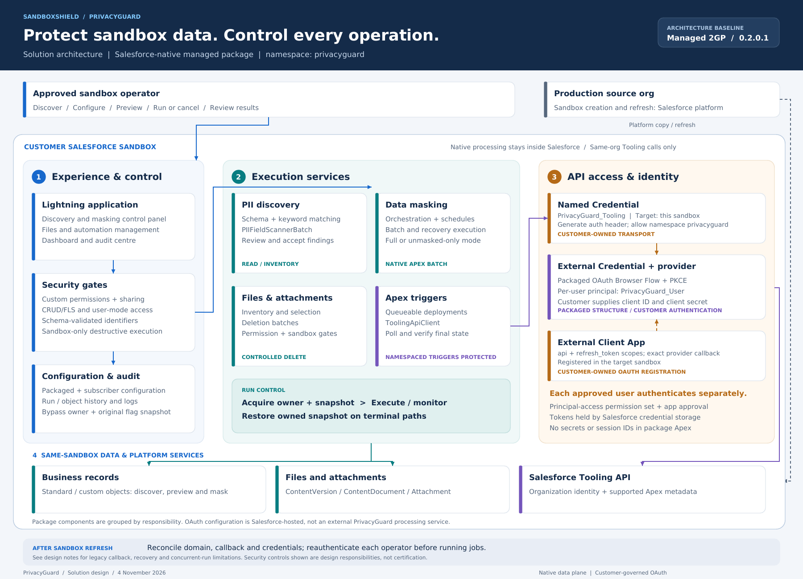

# PrivacyGuard: Solution Architecture and Data-Flow Design

| Document control | Value |
|---|---|
| Document version | 1.0 |
| Prepared | 4 November 2026, Australia/Sydney |
| Product | PrivacyGuard / SandboxShield |
| Publisher | JM Fortune Pty Ltd — project context; confirm final submission identity |
| Namespace | `privacyguard` |
| Package | `0HoQE0000000GUb0AM` |
| Design baseline | 0.2.0.1 / `04tQE00000jQRU5YAO` |
| Intended audience | Salesforce security reviewers, subscriber administrators and solution architects |
| Status | Review draft; implementation evidence and submission readiness remain subject to validation |

## 1. Purpose and scope

PrivacyGuard is a Salesforce-native managed 2GP application for identifying potentially sensitive fields, configuring and executing sandbox masking, managing supported files/attachments, and controlling eligible Apex triggers. This document explains where functionality runs, which data it reads or changes, how privileged access is granted, and where trust boundaries exist.

The design is based on the supplied `force-app(20261103-052010).zip`, delivered bypass-restoration patch, packaged OAuth metadata and subsequent packaging reference correction. It is not a fresh audit of the current remote GitHub head or a byte-for-byte extraction of the compiled package. Confirm the final source/commit, scan reports and submitted package version match before submission.

The reported 0.2.0.1 build succeeded with 84% package coverage and ancestor 0.1.0.6. The last inspected package report showed `Released=false`; promotion has not been confirmed. The owner reported installation in Pguard and earlier successful manual testing of source-deployed changes in PGTEST. These statements do not establish that every managed-subscriber scenario below passed.

### Included

- Keyword/schema-based PII discovery and findings review.
- Packaged masking defaults and subscriber-managed runtime configuration.
- Supported masking strategies, limited previews, job execution, scheduling and failed-record recovery.
- Supported file inventory and deliberate file/attachment deletion.
- Apex trigger listing and controlled deactivate/reactivate operations.
- Operational history, logs, dashboards and cooperative bypass restoration.
- Per-user OAuth through Salesforce Named Credentials for same-sandbox Tooling API access.

### Excluded or not claimed

- Production masking/deletion or a production-block override.
- Data seeding, cross-org data synchronization or an external PrivacyGuard processing service.
- Flow/validation-rule metadata toggling. Cooperative flags can affect subscriber automation only where that automation explicitly checks them.
- Automated legal classification of data, guaranteed anonymization, compliance certification, immutable audit storage or unlimited capacity.
- Automatic OAuth repair after sandbox refresh.

## 2. Solution overview

The diagram is a logical responsibility view. Grouping a packaged credential/provider alongside customer OAuth configuration does not make it customer-owned or independently hosted. All package execution and record processing shown occur in Salesforce. Production-to-sandbox refresh is Salesforce provisioning, not a PrivacyGuard data-transfer job.

| Layer | Responsibility | Representative implementation |
|---|---|---|
| User experience | Configure, inspect, preview, run, cancel and investigate | Lightning Web Components and Apex controllers |
| Authorization and validation | Custom permissions, sharing, relevant CRUD/FLS, schema checks and sandbox safety | PrivacyGuardSecurityService, EnvironmentSafetyService, SchemaValidationUtil, PrivacyGuardSchema |
| Discovery | Inspect schema, match keywords, store/review findings | PIIFieldScannerService, PIIFieldScannerBatch, PIIScanReviewController |
| Policy configuration | Combine packaged defaults and runtime choices | MaskingConfigService, PrivacyGuardConfigurationController |
| Masking execution | Start/track jobs, dispatch batches and recover failures | RuntimeMaskingJobOrchestrator, MaskingJobOrchestrator, MaskingBatch, MaskingFailedRecordRecoveryBatch |
| Scheduling | Start supported configured jobs on schedule | MaskingScheduler, PrivacyGuardWeeklyScheduler, MaskingSchedulerUtil |
| File operations | Inventory, eligibility checks and deliberate deletion | PrivacyGuardFileInventoryController, FileAttachmentPurgeController, FileAttachmentDeletionBatch |
| Trigger operations | Queue deployment, poll and verify resulting state | AutomationManagementController, AutomationTriggerToggleQueueable, ToolingApiClient |
| State and audit | Persist job/object status, errors and bypass snapshot | Native custom objects/settings; MaskingLogger; audit services/controllers |

## 3. Deployment and responsibility boundaries

| Package supplies | Subscriber configures or owns |
|---|---|
| LWC, Apex services, batches and queueables | Business records and authorization decisions |
| Custom objects, settings and metadata defaults | Masking policies, job scope and schedules |
| External Credential and External Auth Identity Provider | External Client App, client ID/secret and OAuth policies |
| Principal-access permission set | Assignments and per-user authentication |
| Named-credential callout reference and same-org validation | Customer-owned `PrivacyGuard_Tooling` Named Credential, target URL and namespace allowance |
| Execution guards and snapshot/restore logic | Monitoring, test data, recovery oversight and retention procedures |

The source project lives in GitHub; Salesforce CLI builds 2GP versions through JMFORTUNE Dev Hub. Runtime processing does not send sandbox records to GitHub, the Dev Hub, the publisher's website or a PrivacyGuard-operated backend in this design. Source scanners receive code/metadata for assessment; they are not runtime processors of the subscriber's business records.

### Environments

- **JMFORTUNE:** Dev Hub/package administration; not the sandbox masking target.
- **PGTEST:** source-deployment development/testing environment.
- **Pguard:** separate subscriber sandbox; owner reported installation of 0.2.0.1.
- **Production:** may hold the installed package/configuration and act as the source of sandbox copies. Read-only discovery is not inherently sandbox-gated, but destructive execution is.

Salesforce normally requests a Developer Edition test org for security review. Because destructive PrivacyGuard features intentionally require a sandbox, confirm the review environment arrangement with Security Review Operations and provide a configured sandbox for those feature tests. Do not weaken sandbox protection to make a Developer Edition walkthrough execute destructive operations.

## 4. Users and authorization

| Actor / operation | Application control | Additional subscriber responsibility |
|---|---|---|
| PII operator | `Manage_PrivacyGuard_PII` custom permission | Appropriate discovery/configuration access |
| Masking operator | `Run_PrivacyGuard_Masking` | Authorized configuration and target record/field access |
| File purge operator | `Purge_PrivacyGuard_Files` | Applicable object/file deletion rights and deliberate selection |
| Trigger administrator | `Use_PrivacyGuard_Metadata_Deactivation` plus sandbox gate | Salesforce API/metadata rights, app approval and own OAuth principal |
| Schedule/batch execution | Permission checks at relevant entry and execution boundaries | Executing user's continuing access and valid environment setup |
| Reviewer | Dedicated test identities with documented roles | Test credentials supplied through submission fields, not this document |

Packaged permission sets include `privacyguard__PrivacyGuard_Admin` and `privacyguard__PrivacyGuard_Tooling_Access`. The Tooling Access set maps the installed external credential principal; it does not, by itself, guarantee every platform or application permission is satisfied.

Controllers/services use sharing declarations and user-mode operations on relevant business and runtime configuration paths. Some platform/configuration queries and internal run/log writes intentionally use system execution. Do not claim every query or write is user mode. See the separate finding register for bounded internal-state and Custom Metadata exceptions.

A legacy production-override permission symbol remains in supplied security-service source. EnvironmentSafetyService does not consult it to permit destructive production execution; its presence must not be presented as an available production override.

## 5. Data inventory and sensitivity

API names below omit the managed namespace for readability.

| Data category | Representative location | Contents / sensitivity | Primary operation |
|---|---|---|---|
| Business data | Selected standard/custom objects | Subscriber records, potentially PII | Preview/read and irreversible field updates |
| Masking defaults | Masking_Configuration__mdt, Masking_Job_Sequence__mdt | Object/field names, strategy/pattern and sequence configuration | Read |
| Runtime configuration | Masking_Field_Config__c, Masking_Job__c, Masking_Job_Object__c | Subscriber policy and execution choices; static patterns may themselves be sensitive | Authorized read/write |
| Discovery vocabulary | PII_Keyword__mdt, PII_Keyword_Config__c | Field-discovery words, not intended credentials or record values | Read; subscriber overrides writable |
| Discovery findings | PII_Scan_Result__c | Schema findings and review state | Create/read/update through supported paths |
| Execution history | Masking_Job_Run__c, Masking_Job_Run_Object__c | Run IDs, initiating-user display information, counts/status and summaries | Internal state writes; authorized review |
| Bypass state | Automation_Bypass__c; Masking_Run_Tracker__c | Boolean flags, owner, Boolean JSON snapshot and coordination state | Privileged internal updates |
| Operational logs | Masking_Log__c | Record IDs, object/field names, messages, technical errors and run references | Internal writes; authorized review |
| Trigger operation tracking | Deactivated_Automation__c and operation status records | Automation identity/status and deployment results | Internal write/review |
| File data | ContentVersion, ContentDocument, ContentDocumentLink, Attachment | File metadata and subscriber content, potentially sensitive | Inventory/read; supported deletion |
| OAuth credentials | Salesforce provider/credential facilities | Client secret and per-user access/refresh tokens | Salesforce-managed authentication; not stored in package Apex |

### Important handling details

- Preview returns limited before/after values to the authorized browser user; it is a real PII read surface, not synthetic output. The implementation limits records/fields and validates accessible targets.
- Logs include technical error messages and identifiers. Salesforce/subscriber automation errors can embed business values. No universal redaction guarantee has been established. Restrict access, review error content and define retention.
- Do not store genuine credentials or production PII in keyword configuration or static masking examples.
- Deleting a ContentDocument may affect multiple links. Inventory/link counts do not automatically establish exclusive ownership.
- This review did not establish encryption at rest for every custom field. Do not describe all custom objects as encrypted just because Salesforce hosts them.

## 6. Data-flow register

| Flow | Origin → destination | Payload / action | Boundary and control |
|---|---|---|---|
| DF-01 | Operator browser → LWC/Apex | User selections, configuration, job requests | Salesforce session and application permission checks |
| DF-02 | Discovery service → schema/configuration | Object/field descriptions and keywords | Native platform access; no external data processor |
| DF-03 | Discovery batch → findings/UI | Candidate field metadata and review state | Authorized review; accepted findings become configuration |
| DF-04 | Preview service ↔ target records → browser | Limited selected values and simulated outcomes | Read-only; schema validation, user mode and field access |
| DF-05 | Job configuration → orchestrator/batches | Validated scope, strategies, run/object identifiers | Run permission, sandbox gate and target validation |
| DF-06 | Masking batch → business records | New masked field values and completion checkbox where configured | Native DML; applicable access and field-type checks |
| DF-07 | Execution → native history/logs | Status, counts, record references and errors | Intentional internal writes; restricted review |
| DF-08 | Bypass service ↔ org-default setting | Original Booleans, owner and temporary true flags | Row lock, owner validation and persistent restoration |
| DF-09 | File inventory/deletion → Salesforce content records | Metadata/eligibility reads and selected deletes | Purge permission, sandbox and file/object access |
| DF-10 | Queueable → Named Credential → Salesforce API | Identity query and supported trigger deployment metadata | HTTPS, per-user OAuth, same-org/sandbox verification |
| DF-11 | Salesforce authorization service ↔ credential facilities | Authorization code/token exchange and renewal | Browser Flow, PKCE, confidential client credentials and platform token storage |
| DF-12 | Production → sandbox | Platform sandbox copy/refresh | Salesforce provisioning; customer reconciles OAuth before use |

## 7. Discovery and policy flow

1. Authorized user launches discovery or reviews existing results.
2. Schema and keyword configuration are read; names/labels are matched and existing configuration is considered.
3. Findings are written to native finding records and shown for review.
4. User accepts appropriate fields or maintains runtime configuration through permission-gated operations.
5. Masking configuration combines packaged defaults with subscriber runtime overrides; target schema/type checks constrain execution.

Keyword-based discovery identifies candidates. It does not prove all PII has been found, infer lawful processing grounds, or inspect every file's contents for PII.

## 8. Preview flow

The preview service checks masking permission, reads the selected job/object in user mode and validates the selected object, fields and completion checkbox. It constructs the query using canonical schema names, adds fixed query syntax and uses user mode. The source limits preview to five records and at most 100 configured fields. Subscriber custom strategy code is not invoked in this read-only preview; supported built-in treatments produce example output.

No DML or automation toggling is performed by the preview service. Source values and examples are returned to the authorized user, so preview visibility requires security testing in its own right.

## 9. Masking execution and lifecycle

1. Validate job state, supported run mode, active object list, configuration and target field compatibility.
2. Create native run/object history and acquire bypass ownership through the shared service. The runtime owner is the run record ID.
3. Persist the original four bypass Booleans, then set cooperative bypass flags for the operation.
4. Dispatch serial or parallel object batches using the configured supported batch size. Full/unmasked-only behavior follows the job configuration.
5. Process chunks and persist DML results, counters, failure references and logs. Native transaction/governor limits apply.
6. Complete or reconcile object state, skip remaining serial work where the failure policy requires, and finalize the parent when no applicable work remains.
7. Restore the snapshot owned by that run on completion, reconciled failure or cancellation paths. Restoration exceptions propagate in runtime finalization, permitting rollback/retry rather than silent success.

### Cancellation and failure

Cancellation requests stop/abort supported active jobs and skip queued work. Already committed chunks are not reversed. A failed batch may require reconciliation triggered by a control-panel read; an independent watchdog is not present. Failed-record recovery is scoped to the selected eligible parent run and job, not an unrestricted arbitrary record replay.

### Bypass restoration semantics

- Snapshot/owner are persistent, not Apex static variables.
- Existing org-default settings are row-locked. Competing first inserts cannot both succeed for the unique org SetupOwnerId; a losing transaction fails and needs a new start attempt.
- Another owner cannot overwrite the snapshot or restore it.
- Restore changes flags still true; it preserves a flag an administrator changed to false during execution.
- A deliberate admin re-save of true is indistinguishable from package-applied true.
- Missing/corrupt snapshot with an owner fails closed and requires investigation; no-owner restore is a no-op.
- Legacy no-argument callers use a fixed legacy owner; stale callbacks are not fully generation-isolated. Exactly-once restoration across all legacy paths is not claimed.

These flags do not deactivate arbitrary metadata. Subscriber triggers/Flows/validation rules must explicitly reference them for cooperative behavior. The retired Flow/validation-rule metadata opt-in now rejects rather than silently continuing.

## 10. File inventory and cleanup flow

Authorized users inspect supported file inventory and related records, select eligible objects/content, and initiate deliberate deletion. Object eligibility and query access are validated. Related attachment/link counts use schema-derived object names and user-mode queries. Supported deletion runs execute in native batches behind purge and sandbox guards.

Current object-selection endpoints retain a maximum of 10 objects per scan/purge selection. Do not describe the present feature as unlimited. File inventory is not file-content classification, malware scanning or automatic regulatory retention enforcement. Confirm multi-link deletion consequences with test content before use.

## 11. Apex trigger and Tooling API flow

1. Authorized trigger administrator selects an eligible non-namespaced trigger and requested state.
2. Queued work calls ToolingApiClient, which checks metadata-management permission and sandbox eligibility.
3. Before Tooling access, the client reads Organization ID and IsSandbox through the Named Credential. The remote ID's first 15 characters must match the executing org and IsSandbox must be true. A successful result is cached only for that transaction.
4. Supported Tooling queries retrieve trigger/class/container status as needed. Controlled container records submit the trigger metadata change.
5. Subsequent work polls deployment status and verifies the resulting trigger state. An HTTP success or queued state alone is not treated as verified activation/deactivation.

### API callout contract

Base endpoint: `callout:PrivacyGuard_Tooling`. Current adapter API version: `v66.0`.

| Method | Relative route / resource | Purpose and data |
|---|---|---|
| GET | `/services/data/v66.0/query/?q=...` | Fixed Organization identity/sandbox preflight; response contains org ID and sandbox flag. |
| GET | `/services/data/v66.0/tooling/query/?q=...` | Queries constrained to supported top-level resources ApexTrigger, ApexClass or ContainerAsyncRequest; receives metadata/status. |
| POST | `/services/data/v66.0/tooling/sobjects/MetadataContainer` | Create controlled deployment container. |
| POST | `/services/data/v66.0/tooling/sobjects/ApexTriggerMember` | Submit selected trigger metadata/body for controlled deployment; trigger source is metadata and may contain sensitive embedded content. |
| POST | `/services/data/v66.0/tooling/sobjects/ContainerAsyncRequest` | Submit asynchronous container operation. |

The adapter is not a general-purpose arbitrary REST proxy. Direct metadata PATCH is retired and rejected. Query-resource matching is not a substitute for reviewing every caller's query construction. HTTP requests use a 20-second timeout in the supplied adapter; asynchronous orchestration and Salesforce API limits still apply.

Error messages returned by the adapter are intentionally bounded and do not return raw response bodies or tokens. Other platform/subscriber errors may still enter operational logs, as described above.

## 12. OAuth and credential architecture

| Component | Configuration |
|---|---|
| Customer-owned Named Credential | Exact unprefixed API name `PrivacyGuard_Tooling`; current sandbox My Domain URL; authorization header enabled; allowed namespace `privacyguard`. |
| Packaged External Credential | `privacyguard__PrivacyGuard_Tooling_OAuth`; OAuth Browser Flow; scope `api refresh_token`. |
| Principal | `PrivacyGuard_User`; Per User Principal; sequence 1. |
| Packaged provider | OAuth authorization-code flow, PKCE, ClientSecretBasic; customer supplies client ID/secret via supported credential setup. |
| Customer External Client App | Target-specific OAuth registration, API/refresh scopes, PKCE and exact generated callback from installed provider. |
| Permission mapping | `privacyguard__PrivacyGuard_Tooling_Access`; packaged reference uses `privacyguard__PrivacyGuard_Tooling_OAuth-PrivacyGuard_User`. |

Each operator authenticates personally. Do not use the publisher's identity or a token copied from another org. Verify app approval, User External Credentials effective permissions and relevant platform rights independently of the principal mapping.

OAuth authorization/token endpoints are Salesforce endpoints, preferably the target sandbox's My Domain. The package defaults to `test.salesforce.com` for its provider endpoints. Copy the callback from the installed provider: namespaced callbacks can differ from unmanaged development callbacks. No credential values are included in this design.

Salesforce credential facilities store tokens and supply authorization headers; Apex does not retrieve a session ID or hard-code a Bearer token. Client credentials and per-user authentication are not populated by installing the package. The separate post-install guide provides the exact setup procedure.

## 13. Trust boundaries and control decisions

| Boundary | Principal concern | Design response / validation requirement |
|---|---|---|
| Browser → server | Unauthorized privileged method invocation | Server-side custom-permission checks, not UI visibility alone; test users without permissions. |
| Configuration → dynamic query | Identifier injection or inaccessible fields | Canonical schema names, validations, bound values where applicable and user-mode reads; verify malicious-input tests. |
| Managed package → subscriber business data | Unintended data access/change | Sharing/access/type checks, selected scope, safety acknowledgement and sandbox gates; inspect exceptions explicitly. |
| Operator → internal state | Tampering with ownership/history | Intentional system writes behind gates; public-setting integrity must be reviewed in subscriber org. |
| Apex → Named Credential | Missing permission, wrong host or identity | Principal mapping, namespace allowlist, same-org/sandbox preflight and per-user auth. |
| Job → terminal/recovery state | Duplicate callbacks, abandoned runs, lost bypass settings | Runtime owner/snapshot checks and reconciliation; legacy and watchdog limitations remain. |
| Production → refreshed sandbox | Stale endpoints or authentication | Post-refresh reconciliation and reauthentication; no automatic trust in copied tokens/configuration. |

## 14. Scalability and operational considerations

Native Batch Apex supports chunked processing; serial/parallel choices remain subject to org batch, queue and governor limits. Batch processing is not a guarantee of arbitrary volume or throughput. Shared coordination rows can contend, and concurrent jobs must not independently modify a single bypass snapshot. The new service rejects overlapping owners rather than allowing unrestricted concurrent destructive runs.

Schema validation, finite previews and the current file-selection cap limit synchronous work. Scheduling and OAuth still depend on the executing identity and organization policies. API capacity, row locks, log growth and native storage must be monitored. No external queue, cache, processing cluster or automatic horizontal scaling service is introduced.

Define operational retention for findings/history/logs and file inventory. No automated purge schedule or immutable-retention guarantee was established by this review. Do not promise that deleted data is unrecoverable from all Salesforce backups or retention facilities.

## 15. Deployment, refresh and change management

1. Freeze and identify the intended source revision; retain configuration and scan provenance.
2. Build a new 2GP version with validation and coverage, linked to the highest appropriate released ancestor.
3. Install in a separate subscriber sandbox and configure the installed OAuth chain; source-deployment tests alone are insufficient.
4. Validate discovery, preview, masking, cancellation, failure recovery, file handling, eligible trigger operations and denied-access cases.
5. Reconcile final scanner findings and documentation; promote only the intended validated build. Release is not security-review approval.
6. Provide reviewer environments, credentials via submission fields, reports and accurate operating instructions.

Following sandbox refresh, recheck the target domain, installed provider callback, app registration/credentials, NC target and installed links, namespace allowance, assignments and each user's authentication. Confirm same-sandbox reads and safe test-trigger state changes before running real jobs. Never bypass identity/sandbox checks to repair setup.

## 16. Validation status and reviewer evidence

| Item | Evidence available / status |
|---|---|
| 0.2.0.1 package creation | User-supplied success output; reported package coverage 84%, correct released ancestor. |
| Pguard managed installation | Owner reported successful installation; detailed runtime results not subsequently supplied. |
| PGTEST OAuth read | Supplied diagnostic log returned HTTP 200 and same-sandbox verification. |
| Trigger deactivate/reactivate | Owner reported success in source-tested PGTEST. This does not prove managed Pguard configuration. |
| Bypass patch deployment/testing | Owner reported deployment and “tested and looks good”; per-scenario evidence/test summary not supplied. |
| Code Analyzer | Latest supplied CSV: 23 findings, 15 high and 8 moderate; justification register remains provisional. |
| Checkmarx | Not supplied. |
| Package promotion | Last inspected report showed false; not confirmed afterward. |
| Final source/scan/package match | Needs retained commit/build provenance and final report comparison. |

### Reviewer validation scenarios

- Run discovery with approved access; reject configuration/run/purge/metadata entry points for unassigned users.
- Try unknown/malicious object and field identifiers and inaccessible targets; confirm denial and no unauthorized disclosure or mutation.
- Verify preview performs no DML and cannot expose inaccessible fields.
- Test masking completion, partial failure, cancellation and recovery on synthetic records, retaining already-committed-chunk semantics.
- Start jobs with mixed bypass values; test restoration, competing owners and a corrupt snapshot recovery procedure.
- Verify same-org OAuth, wrong-org rejection, production rejection, permission denial, token renewal and managed namespace/principal configuration.
- Check supported trigger state transitions and protected namespaced rows.
- Test file deletion with singly/multiply linked content and restricted users.

This list defines required evidence to collect, not tests already passed. Production blocking should be checked safely without permitting real destructive data operations.

## 17. Remaining limitations and submission caveats

The capability diagram and this design do not close the 23 scanner findings or certify the product. Review system-state exceptions, public-setting integrity, logging sensitivity, legacy stale callbacks, first-use coordination, abandoned-run recovery and genuine concurrency evidence before claiming the corresponding risks are resolved. Preserve current scope limits, including the 10-object file-selection cap.

Documents must describe actual deployed behavior. Do not invent certifications, penetration-test results, policies, cryptographic guarantees, support SLAs or retention commitments. No independent verification of every path or current remote repository revision was performed for this document.

## 18. Related deliverables

- `PrivacyGuard-Solution-Architecture.pdf` / `.svg` / `.png` — logical diagram.
- `PrivacyGuard-Security-Review.md` — finding-by-finding justification candidates and evidence gaps.
- `PrivacyGuard-OAuth-Post-Install-Guide.md` — subscriber credential setup, authentication and refresh reconciliation.
- `PrivacyGuard-Business-Capability-Map` — business capabilities, not a replacement for this technical design.

## 19. Official platform references

- Required review materials: https://developer.salesforce.com/docs/platform/isvforce/guide/security-review-required-materials.html
- Named Credential packaging: https://developer.salesforce.com/docs/platform/named-credentials/guide/nc-package-credentials.html
- Populate external credentials: https://developer.salesforce.com/docs/platform/named-credentials/guide/nc-populate-external-credentials.html
- Apex data access: https://developer.salesforce.com/docs/platform/lwc/guide/apex-security
- Secure dynamic SOQL guidance: https://developer.salesforce.com/docs/platform/secure-coding/guide/secure-coding-sql-injection.html
- Diagram style inspiration: https://architect.salesforce.com/docs/architect/reference-diagrams/guide/aws-data-360

Platform references explain general behavior; the supplied PrivacyGuard source and separately retained tests are required to substantiate implementation-specific claims.
